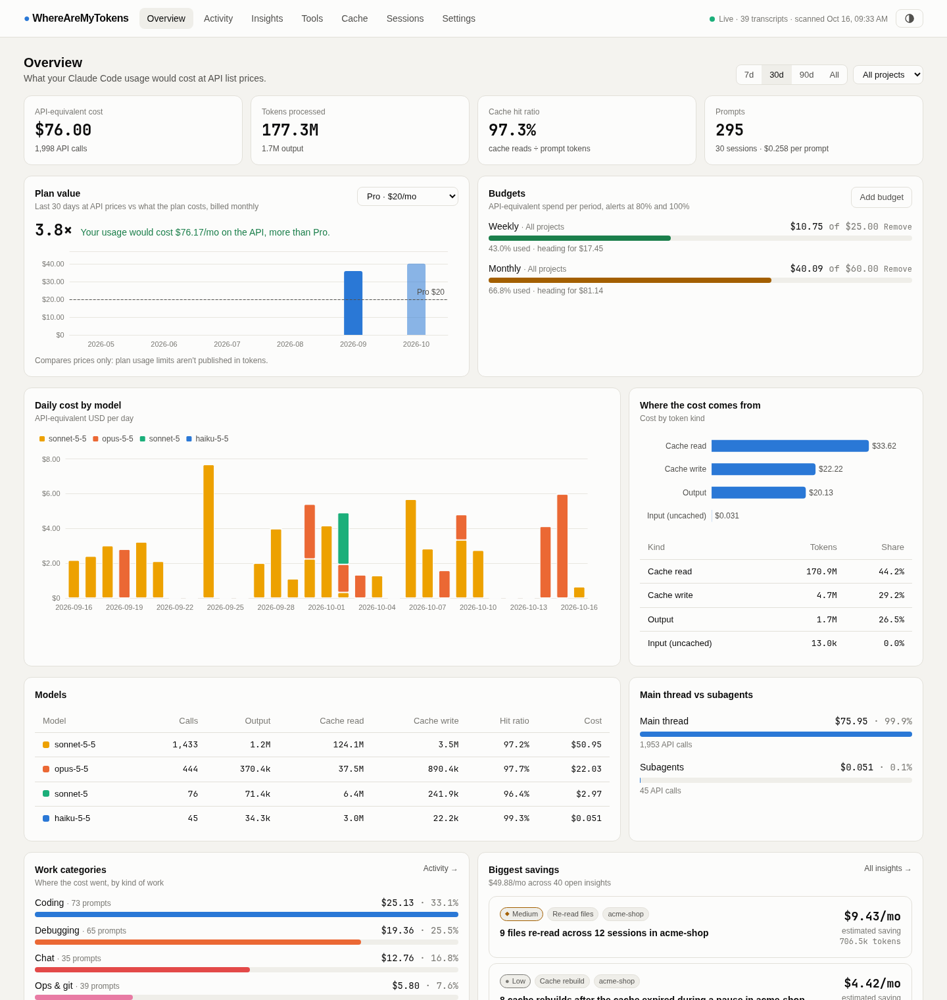
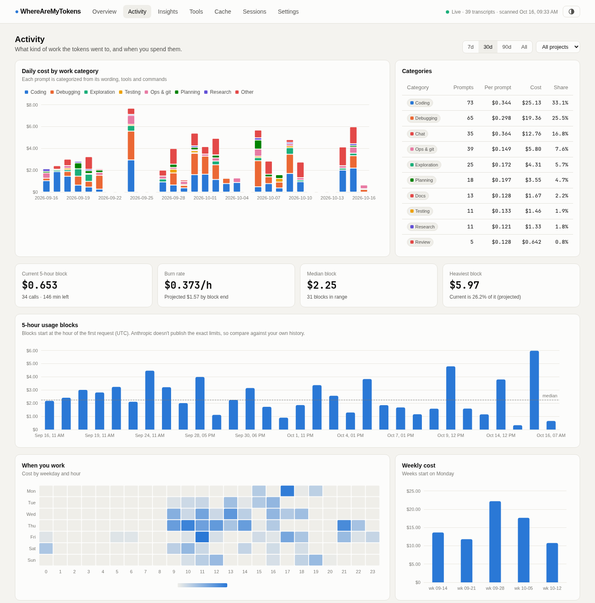
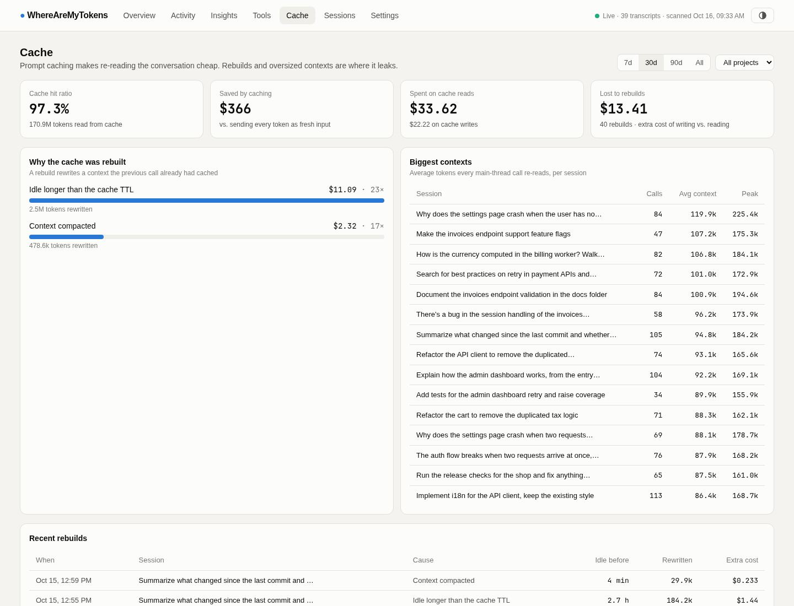
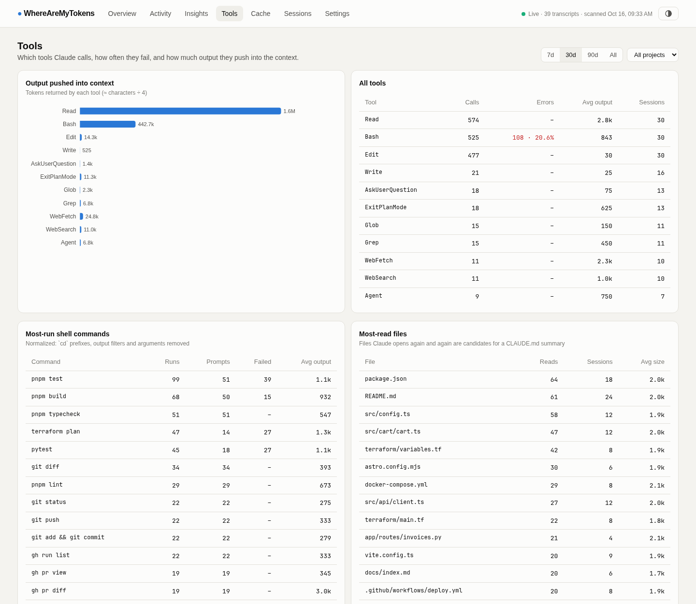
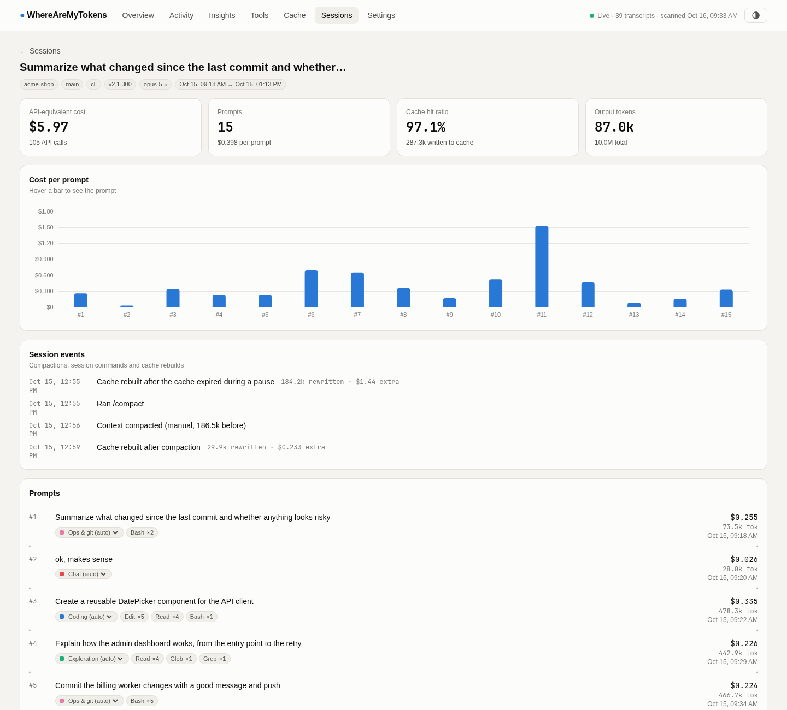
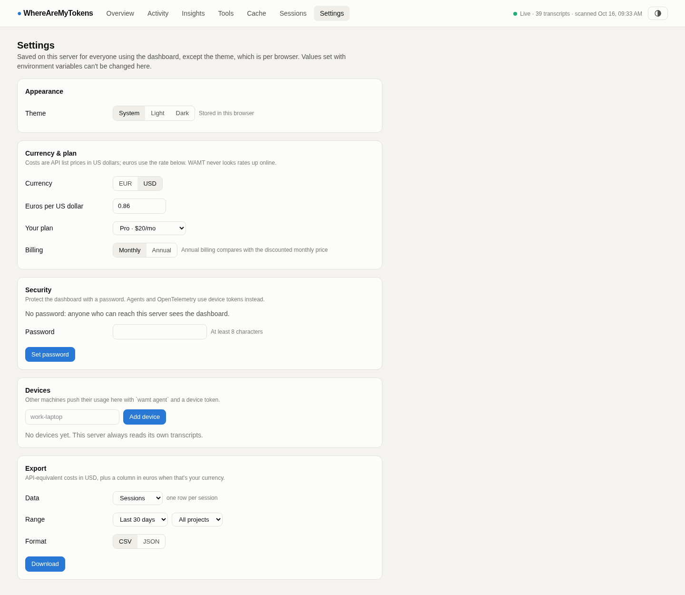
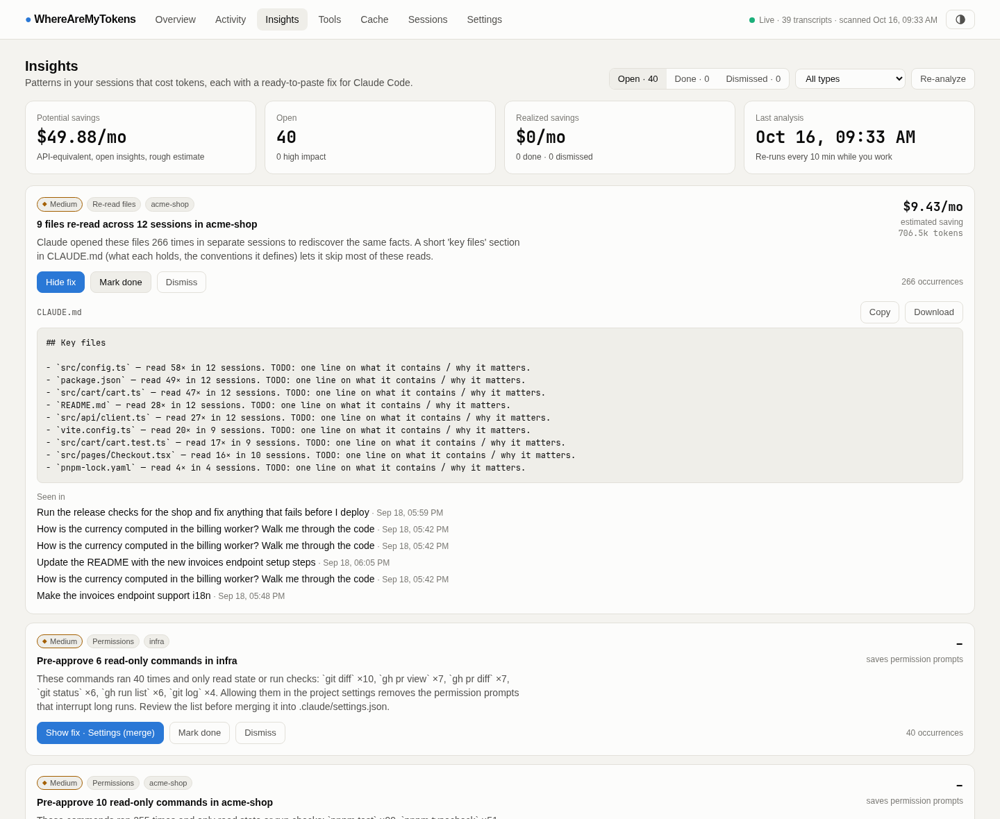

<div align="center">

# WhereAreMyTokens

**See where your Claude Code tokens go, what they would cost on the API, and what to automate to spend less.**

Self-hosted usage analytics for Claude Code Pro/Max subscriptions. One `docker compose up`, read-only access to your local transcripts, nothing leaves your machine.

[](https://github.com/Gerijacki/WhereAreMyTokens/actions/workflows/ci.yml)
[](https://github.com/Gerijacki/WhereAreMyTokens/releases)
[](https://github.com/Gerijacki/WhereAreMyTokens/pkgs/container/wherearemytokens)
[](LICENSE)


**Try it in one command**, on synthetic data (nothing from your machine is read):

```bash
docker run --rm -p 8788:8787 ghcr.io/gerijacki/wherearemytokens demo    # then open http://localhost:8788
```

[Quick start](#quick-start) · [Try the demo](#try-it-with-demo-data) · [Features](#features) · [Insights](#automate-this-insights) · [Self-hosting](#self-hosting) · [FAQ](#faq)

</div>

---

## Why

A Claude Code subscription has no per-token bill, so it's hard to answer simple questions:

- How much would this month have cost on the API? Is the Max plan worth it?
- Am I on track to stay under the budget I set myself, overall or for one client project?
- Which projects, sessions and prompts burn the most?
- Is the time going to coding, debugging, or exploring the same code over and over?
- Why did a 5-hour window run out so fast?
- **What should I turn into a skill, a slash command, a hook or a `CLAUDE.md` line so it stops costing tokens?**

WhereAreMyTokens reads the transcripts Claude Code already writes to `~/.claude/projects` and answers all of them in a dashboard.

## Quick start

```bash
git clone https://github.com/Gerijacki/WhereAreMyTokens.git
cd WhereAreMyTokens
cp .env.example .env          # set CLAUDE_PROJECTS_DIR if your transcripts aren't in ~/.claude/projects
docker compose up -d --build
```

Open **http://localhost:8787**. The first start imports your whole history (a few seconds for tens of MB). After that, new activity shows up within seconds.

> On Windows, set `CLAUDE_PROJECTS_DIR=C:/Users/<you>/.claude/projects` in `.env`.

Prefer a single container with SQLite instead of PostgreSQL? Mount your transcripts and a volume for the history:

```bash
docker run -d --name wamt -p 8787:8787 -v ~/.claude/projects:/data/claude:ro -v wamt-data:/data/wamt \
  ghcr.io/gerijacki/wherearemytokens
```

### Try it with demo data

No Claude Code history yet, or want to look before mounting your own data? The demo generates realistic synthetic transcripts and doesn't read anything from your machine. Run `docker run --rm -p 8788:8787 ghcr.io/gerijacki/wherearemytokens demo`, or build it from the repo:

```bash
docker compose -f docker-compose.demo.yml up --build    # http://localhost:8788
```

## Features

| | |
|---|---|
| **API-equivalent cost** | Every response priced per model and token kind: input, output, 5-minute and 1-hour cache writes, cache reads. The prices live in an editable [`pricing.yaml`](backend/wamt/pricing/pricing.yaml). |
| **Plan value** | The last 30 days at API prices against the price of Pro, Max 5x and Max 20x (monthly or annual billing), month by month: how many times over your plan pays for itself, or whether pay-as-you-go would have been cheaper. |
| **Budgets** | Daily, weekly or monthly limits on API-equivalent spend, overall or per project, with a projection to the end of the period and alerts at 80% and 100%. |
| **Work categories** | Each prompt is classified as coding, debugging, exploration, testing, ops, planning, research, review, docs or chat, from its wording (English/Catalan/Spanish), tools, shell commands and signals such as plan mode or retries after errors. You can override any prompt; your choice sticks. |
| **5-hour blocks & burn rate** | Usage grouped the way subscription windows work, with the current burn rate, the projected block cost and your own historical median and peak. |
| **Cache analytics** | Hit ratio, savings from caching, and every **cache rebuild** with its cause: idle past the TTL, compaction, model switch or a changed prompt prefix. Also shows which sessions carry the biggest context. |
| **Tools** | Which tools and normalized shell commands run most, fail most and push the most output into the context. |
| **Sessions** | Replay every session prompt by prompt: cost, tokens, tools, category, compactions and rebuilds. |
| **Insights** | Ten detectors that find wasted tokens and give you a ready-to-paste fix (see below), and the savings each fix actually delivered once you apply it. |
| **Settings** | Light, dark or system theme; euros or dollars (at a rate you set); your plan and billing; the dashboard password; agent devices; all from the UI. |
| **Export** | Sessions, prompts and daily costs per project and model as CSV or JSON, for billing clients or your own analysis. |
| **Self-hosting** | Multi-device agent, optional password or reverse-proxy auth, ntfy/Discord/Slack alerts, Prometheus `/metrics`, OpenTelemetry receiver, privacy mode. |

<picture>
  <source media="(prefers-color-scheme: dark)" srcset="docs/screenshots/overview-dark.png">
  
</picture>

<table>
<tr>
<td width="50%"><picture><source media="(prefers-color-scheme: dark)" srcset="docs/screenshots/activity-dark.png"></picture></td>
<td width="50%"><picture><source media="(prefers-color-scheme: dark)" srcset="docs/screenshots/cache-dark.png"></picture></td>
</tr>
<tr>
<td width="50%"><picture><source media="(prefers-color-scheme: dark)" srcset="docs/screenshots/tools-dark.png"></picture></td>
<td width="50%"><picture><source media="(prefers-color-scheme: dark)" srcset="docs/screenshots/session-dark.png"></picture></td>
</tr>
<tr>
<td colspan="2" align="center"><picture><source media="(prefers-color-scheme: dark)" srcset="docs/screenshots/settings-dark.png"></picture></td>
</tr>
</table>

## "Automate this" insights

The part that pays for itself. Every insight shows the evidence (links to the exact prompts), an estimated monthly saving and a file you can paste into your project:

<picture>
  <source media="(prefers-color-scheme: dark)" srcset="docs/screenshots/insights-dark.png">
  
</picture>

| Insight | What it detects | The fix it generates |
|---|---|---|
| **Large context** | Sessions whose every call re-reads 150k+ tokens | When to `/clear` and `/compact` |
| **Cache rebuild** | Context rewritten after idling, prefix changes or model switches | How to avoid that cause |
| **Context bloat** | A single tool result over 15k tokens (lockfiles, logs, builds) | A `permissions.deny` rule or a `CLAUDE.md` instruction |
| **Repeated sequence** | The same chain of shell calls across prompts (`lint → typecheck → test → build`) | A **skill** (`.claude/skills/*/SKILL.md`) that runs it in one step |
| **Fix loop** | A failing command re-run again and again across prompts | A `PostToolUse` **hook** that surfaces the error right after each edit |
| **Re-read files** | Files Claude opens again in session after session | A "Key files" section for `CLAUDE.md` |
| **Repeated prompt** | Near-identical prompts | A **slash command** |
| **Noisy output** | Commands whose output is large every time | A `CLAUDE.md` rule to trim it |
| **Model fit** | Exploration/chat prompts run on the most expensive model | A read-only **subagent** on a cheaper model |
| **Permissions** | Frequent read-only commands that need approval | A `permissions.allow` list for `settings.json` |

Savings are estimates. Most are measured in avoided model round trips: in Claude Code every tool call is followed by another call that re-reads the whole context. Each detector states its assumption.

### Realized savings

When you mark an insight **done**, its estimate is frozen. After a week, the detectors run again on the data recorded since then, and the insight shows what the fix actually saved per month: the frozen estimate, scaled by how much you've used Claude Code since (so a quiet week doesn't count as savings), minus whatever cost the pattern still causes. The Insights page adds them up in **Realized savings**.

## How it works

```
~/.claude/projects/**/*.jsonl ──(read-only, incremental)──► collector ──► PostgreSQL ──► FastAPI ──► React dashboard
other machines ── wamt agent (slimmed + redacted records) ──┘    │
Claude Code OpenTelemetry (OTLP/JSON) ──────────────────────────┘    └─► categories · cache analysis · insight miners
```

- **Exact totals.** Claude Code writes one transcript line per content block and repeats the response's `usage` on each line. Responses are deduplicated by message id; without that, totals come out 2–5× too high.
- **Prompt attribution.** Every API call is attached to the human prompt that caused it, including calls from the subagents that prompt spawned. Harness messages (task notifications, hand-backs, IDE context, `/model`, `/compact`) aren't counted as prompts.
- **Command signatures.** `cd "<project>" && pnpm build 2>&1 | tail -n 5` is counted as `pnpm build`, so repeats can be detected.
- **Polling, not file events.** inotify doesn't cross Docker bind mounts on Windows/macOS, so changed files are re-read from their last byte offset.

## Self-hosting

All configuration is in environment variables. See [`.env.example`](.env.example).

### Several machines

Run one server and an agent on each extra machine. The agent sends only what the analytics need: usage numbers, tool names and targets, and redacted prompt text. It never sends file contents, tool output or model responses.

```bash
docker compose exec wamt wamt device add work-laptop      # on the server: prints a token once
pip install "git+https://github.com/Gerijacki/WhereAreMyTokens.git#subdirectory=backend"   # on the laptop
wamt agent --server https://wamt.example.com --token wamt_xxx            # add --no-prompts to send no prompt text
```

Or run it with Docker using [`docker-compose.agent.yml`](docker-compose.agent.yml).

### Privacy

- **Read-only.** Transcripts are mounted read-only and nothing is sent anywhere unless you configure an agent or alerts.
- **Secret redaction** (`WAMT_REDACT_SECRETS=true`, the default) masks API keys (Anthropic, OpenAI, GitHub, AWS, Stripe, Slack…), bearer tokens, URL credentials, `PASSWORD=`-style assignments, private keys and email addresses before anything is stored.
- **`WAMT_STORE_PROMPTS=false`** keeps only each prompt's length and category, never the text.
- **OpenTelemetry.** Identity attributes (`user.email`, account and organization ids) are dropped as soon as they arrive.

### Access control

- **A dashboard password**, set in *Settings → Security* (stored as a salted scrypt hash) or with `WAMT_AUTH_PASSWORD`, which takes precedence and can't be changed from the UI. You get a login page and a signed session cookie; changing or removing the password signs every other browser out.
- `WAMT_TRUST_PROXY_AUTH_HEADER=Remote-User`: trust Authelia, oauth2-proxy, Cloudflare Access and similar.
- Agents and OpenTelemetry authenticate with device tokens, which you can create and revoke in *Settings → Devices* or with `wamt device`. `/metrics` can require `WAMT_METRICS_TOKEN`.

### Settings and environment variables

Everything in *Settings* except the theme is saved on the server, for everyone using the dashboard. Environment variables always win: a setting that comes from one (for example `WAMT_CURRENCY`) shows as locked in the UI. The API serves every amount in US dollars and the dashboard converts it for display, so switching currency never rewrites your data. WAMT doesn't look exchange rates up online: set `WAMT_EUR_PER_USD` or edit the rate in Settings.

### Alerts

Set `WAMT_ALERT_URL` to an [ntfy](https://ntfy.sh) topic, a Discord or Slack webhook, or any JSON endpoint. You'll get:

- a warning when the current 5-hour block is heading above `WAMT_ALERT_BLOCK_FACTOR` × your median block;
- a notification for every new high-impact insight;
- a notification when a budget reaches 80% of its limit, and another when it's exceeded (once per period);
- an optional daily digest at `WAMT_ALERT_DIGEST_HOUR`.

Test it with `docker compose exec wamt wamt test-alert`.

### Prometheus & Grafana

`GET /metrics` exposes tokens and cost by model and kind, the cache hit ratio, current-block cost and burn rate, and open insights and their savings.

### OpenTelemetry

Claude Code can also push telemetry directly, which is useful where the transcripts aren't reachable:

```bash
export CLAUDE_CODE_ENABLE_TELEMETRY=1 OTEL_METRICS_EXPORTER=otlp OTEL_LOGS_EXPORTER=otlp
export OTEL_EXPORTER_OTLP_PROTOCOL=http/json OTEL_EXPORTER_OTLP_ENDPOINT=http://localhost:8787
export OTEL_EXPORTER_OTLP_HEADERS="Authorization=Bearer wamt_xxx"   # when auth is enabled
```

### Keep your history

Claude Code deletes transcripts older than `cleanupPeriodDays` (30 by default). WhereAreMyTokens keeps everything it has already imported, but it can't recover what was deleted before it first ran. To keep more history on disk, raise `cleanupPeriodDays` in `~/.claude/settings.json`.

## FAQ

**Is this the real amount I pay?** No. It's what the same usage would cost at API list prices, which is the useful number for comparing plans, projects and habits. Subscription limits aren't published, so 5-hour blocks are compared with your own history.

**Does "Plan value" tell me whether I'd fit in a cheaper plan?** No. Plan usage limits aren't published in tokens, so it compares prices only. Pick your plan and billing in Settings (or with `WAMT_PLAN` and `WAMT_BILLING`), and edit the `plans` section of [`pricing.yaml`](backend/wamt/pricing/pricing.yaml) if the prices change. It lists prices in euros and dollars.

**Can I see the costs in euros?** Yes. Euros are the default display currency; switch to dollars in Settings or with `WAMT_CURRENCY=USD`. Exports always include the USD cost, plus a `cost_eur` column when the currency is EUR.

**How is this different from `ccusage` and other CLI tools?** CLI tools are great for a quick total in the terminal. WhereAreMyTokens is a long-running dashboard: it keeps history beyond Claude Code's cleanup, merges several machines, classifies the work, explains cache behavior, and suggests concrete automations with the files to make them.

**Does it work with the API, Bedrock or Vertex instead of a subscription?** Yes. It reads the same transcripts. With API billing the cost column is close to your real bill.

**Which models are priced?** Every current Claude model in [`pricing.yaml`](backend/wamt/pricing/pricing.yaml). Unknown models show as unpriced instead of being guessed.

## Development

On Linux and macOS the `Makefile` wraps the usual steps (Python 3.12+, [uv](https://docs.astral.sh/uv/), Node 22+ and pnpm):

```bash
make setup      # backend venv + web dependencies
make dev-api    # demo data in .dev/ and the API on :8787 (SQLite)
make dev-web    # http://localhost:5173, proxies /api to :8787
make check      # pytest, ruff, Vitest and the production build
make e2e        # Playwright end-to-end tests against the real backend on demo data
make screenshots  # regenerate the README screenshots and docs/demo.gif from demo data (needs ffmpeg)
```

Or by hand:

```bash
cd backend && python -m venv .venv && .venv/bin/pip install -e ".[dev]"
.venv/bin/pytest -q && .venv/bin/ruff check wamt tests
.venv/bin/wamt demo --dir /tmp/demo && WAMT_CLAUDE_DATA_DIR=/tmp/demo .venv/bin/wamt serve   # API on :8787 (SQLite)

cd web && pnpm install && pnpm dev     # http://localhost:5173, proxies /api to :8787
pnpm test                              # unit tests (Vitest)
pnpm exec playwright install chromium && pnpm test:e2e   # end-to-end tests
```

CLI commands:

| Command | What it does |
|---|---|
| `wamt serve` | Runs the API, the dashboard and the collector |
| `wamt ingest` | Runs one scan |
| `wamt enrich` | Recomputes categories and cache analysis |
| `wamt insights` | Recomputes and prints the insights |
| `wamt reprice` | Recomputes costs after a pricing change |
| `wamt device add\|list\|revoke` | Manages agent devices |
| `wamt agent` | Pushes this machine's transcripts to a server |
| `wamt demo` | Generates synthetic transcripts |
| `wamt test-alert` | Sends a test notification |

Architecture notes for contributors are in [CLAUDE.md](CLAUDE.md), and the contribution process in [CONTRIBUTING.md](CONTRIBUTING.md).

## Roadmap

- [x] Ingest, dedupe, API-equivalent costs, Overview and Sessions
- [x] Work categories, 5-hour blocks, Tools and Cache dashboards
- [x] Ten insight detectors with ready-to-paste fixes
- [x] Multi-device agent, auth, alerts, OpenTelemetry, Prometheus, privacy mode, Alembic migrations
- [ ] Optional LLM classifier (Haiku or local Ollama) for ambiguous prompts
- [x] Budgets with alerts, plan comparison (Pro vs Max vs API) and realized savings
- [ ] Weekly report email and shareable read-only links

Ideas and insight detectors are very welcome. Open an issue with the *Insight idea* template.

If WhereAreMyTokens saved you tokens, a ⭐ helps other Claude Code users find it.

## License

[MIT](LICENSE). Not affiliated with Anthropic. "Claude" and "Claude Code" are trademarks of Anthropic.
